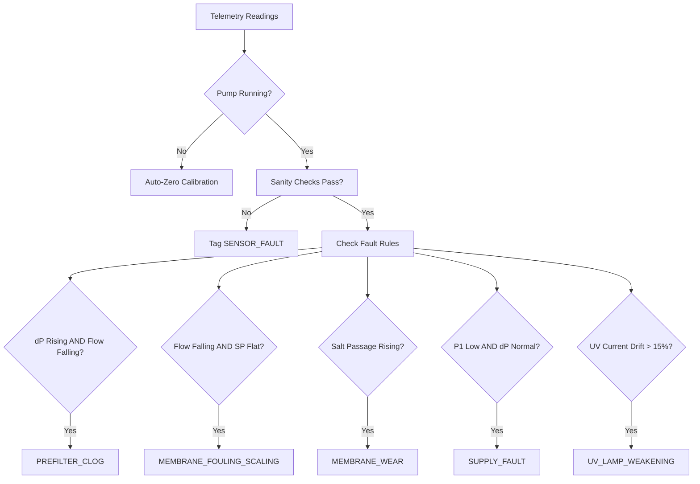

# PureCast Algorithms Specification

This document details the exact mathematical models, physics principles, and heuristic rule structures implemented across the PureCast platform.

---

## 1. Preprocessing & Signal Filtering

### 1.1 Rolling Median Filter
- **Window**: 60 seconds rolling window.
- **Activation Gate**: Evaluated **only** when pump status == `ON` ($flow > 0.05$ L/min or pump contactor energized). When pump is `OFF`, raw pressure values are channeled to the auto-zero baseline tracker, not the operational filter.
- **Formulation**:
  $$y_t = \text{median}\left(\{x_{t-k}, \ldots, x_t\} \mid \text{pump}(t-i) = 1\right)$$

### 1.2 Sensor Sanity Checking
Data flagged with any sanity violation is immediately tagged as `SENSOR_FAULT` with an explicit sub-type. **Sensor faults never trigger cartridge replacement recommendations.**

| Fault Sub-Type | Detection Condition | Action |
| :--- | :--- | :--- |
| `TDS_INVERSION` | $TDS_{out} > TDS_{in} + \epsilon$ ($\epsilon = 5$ ppm) | Drop reading, flag sensor defect |
| `FLOW_WHILE_PUMP_OFF` | $flow > 0.1 \text{ L/min}$ while pump signal is 0 | Flag valve or flowmeter leak |
| `FROZEN_VALUE` | $\sigma(x_{t-N:t}) = 0$ over $\ge 5$ samples across 300 s | Flag stuck transducer ADC |
| `OUT_OF_RANGE` | $x_t \notin [x_{\min}, x_{\max}]$ (e.g. Temp $< 2^\circ$C or $> 50^\circ$C) | Discard reading |
| `SENSOR_DROPOUT` | No telemetric packet received for $> 180$ seconds | Tag offline, fall back to physics prior |

---

## 2. Physics-Based Normalization

### 2.1 Temperature Normalization
Membrane permeability increases by approximately $2.5\%$ per $1^\circ\text{C}$ rise relative to $25^\circ\text{C}$ due to changes in water viscosity.
$$Q_{norm} = \frac{Q_{raw}}{1 + 0.025 \cdot (T_{water} - 25.0)}$$

### 2.2 Net Driving Pressure (NDP) Correction
Permeate flux is driven by the net pressure gradient across the semi-permeable membrane minus osmotic pressure:
$$\Delta P_{net} = (P_{feed} - P_{permeate}) - (\Pi_{feed} - \Pi_{permeate})$$
Where osmotic pressure is approximated from dissolved solids:
$$\Pi \approx 0.0075 \cdot TDS \quad (\text{bar})$$
Specific normalized flux:
$$J_{norm} = \frac{Q_{norm}}{\Delta P_{net} / \Delta P_{baseline}}$$

### 2.3 Auto-Zero Pressure Calibration
When the pump is `OFF` for $> 30$ seconds and flow is 0, pressure transducers ($P_1, P_2, P_3$) should read atmospheric gauge pressure (0.0 bar). The rolling mean during pump-off state is stored as $P_{offset}$ and subtracted dynamically during active operation.

---

## 3. End-of-Life (EOL) Baselines

Rather than hardcoded absolute limits, all thresholds are tracked relative to each specific installation's new-state baseline established during the first 48 hours of run-time:
$$Baseline_0 = \text{median}(X_{first\_48h\_runtime})$$

| Consumable | Primary Metric | EOL Boundary |
| :--- | :--- | :--- |
| **SEDIMENT** | Pre-filter $\Delta P = P_1 - P_2$ | Rises by $10\% - 15\%$ above baseline |
| **RO MEMBRANE (Fouling)** | Normalized Flow $Q_{norm}$ | Drops by $10\%$ below baseline |
| **RO MEMBRANE (Wear)** | Salt Passage $SP = \frac{TDS_{out}}{TDS_{in}}$ | Rises by $5\% - 10\%$ relative to baseline |
| **UV LAMP** | Lamp Current $I_{uv}$ & Hours | Current drift $> 15\%$ or run-time $\ge 365$ days |
| **CARBON / PROTECTOR** | Volumetric Salt Load $\sum (L \times TDS)$ | Reaches rated total capacity (L) |

---

## 4. Health Index (HI) Computation (0 - 100%)

The Health Index represents remaining operational capacity:
$$HI(t) = \max\left(0.0, \min\left(100.0, 100 \times \left(1.0 - \frac{M(t) - M_0}{M_{EOL} - M_0}\right)\right)\right)$$

### Mode-Aware Ageing Multipliers
Operating modes impart different degradation stresses:
- **RO Mode**: Base multiplier $= 1.0$
- **UF / UV Mode**: Membrane bypassed or idle, ageing rate multiplier $= 0.30$
- **VACAY Mode**: Stagnation conditions. Ageing rate multiplier $= 0.05$ (accounts for bio-fouling during stagnation)

---

## 5. Prognostics: Dual-State Kalman Filter

### 5.1 State-Space Formulation
State vector:
$$\mathbf{x}_k = \begin{bmatrix} HI_k \\ \dot{HI}_k \end{bmatrix} = \begin{bmatrix} \text{Current Health (\%)} \\ \text{Rate of Health Decay (\%/day)} \end{bmatrix}$$

State transition matrix for sample interval $\Delta t$ (days):
$$\mathbf{F} = \begin{bmatrix} 1 & \Delta t \\ 0 & 1 \end{bmatrix}$$

Process noise covariance $\mathbf{Q}$ and Measurement noise covariance $\mathbf{R}$:
$$\mathbf{Q} = \begin{bmatrix} \frac{\Delta t^3}{3} q_{hi} & \frac{\Delta t^2}{2} q_{hi} \\ \frac{\Delta t^2}{2} q_{hi} & \Delta t \cdot q_{rate} \end{bmatrix}, \quad \mathbf{R} = \sigma_{meas}^2$$

### 5.2 Prediction & Remaining Life Calculation
Estimated remaining days until $HI = 0$:
$$RUL_{days} = \frac{HI_k}{-\dot{HI}_k}$$

### 5.3 Early-Warning Bias & Learning Band
- **Safety Bias**: We apply an early bias factor $\beta = 0.85$ to $RUL_{nominal}$ so that households receive timely service scheduling before membrane failure occurs.
- **Cold Start Learning Band**: During the first 14 days of an installation, uncertainty is high. The confidence interval is explicitly expanded using physics priors:
  $$\text{Band}(t) = \pm \max\left(\sigma_{kalman}, \sigma_{prior} \cdot e^{-t / 14}\right)$$

---

## 6. Explainable Diagnosis Engine

Alerts require **TWO independent physical indicators** to agree simultaneously, preventing false dispatches.

### Event Tagging (Suppression Rules)
- **Power Cuts**: Incomplete operating cycle logged without pressure drop flag.
- **Cold Morning**: Raw flow drops but temperature-corrected flow $Q_{norm}$ remains constant $\implies$ suppress alarm.
- **Supply Outage**: Municipal inlet pressure drops $\implies$ label `SUPPLY_FAULT` ("supply problem, not a purifier problem").
