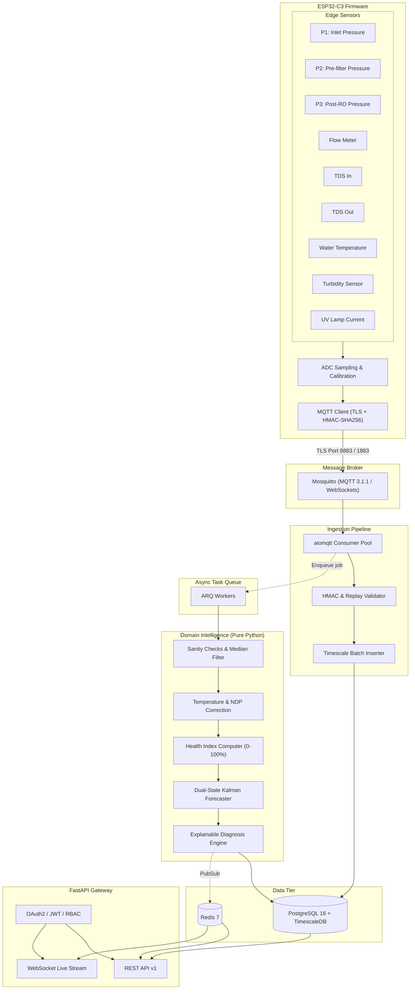

# PureCast System Architecture

## Overview

PureCast is an intelligent filter-health forecasting and diagnostics platform for water purifiers (Track 2, atomQUEST 2026). It combines physics-based priors with real-time sensor processing and ML gradient-boosted trees to predict consumable exhaustion, detect faults early, and automate supply-chain fulfillment.



## Architectural Layers (Hexagonal Architecture)

```
┌─────────────────────────────────────────────────────────────────┐
│                       api / workers / cli                       │  Driving Adapters
│  (FastAPI routers, WebSocket, ARQ worker tasks, CLI commands)   │
├─────────────────────────────────────────────────────────────────┤
│                          application                            │  Application Services
│       (Use cases, DTOs, Port Interfaces, Authorization)         │
├─────────────────────────────────────────────────────────────────┤
│                            domain                               │  Pure Domain Core
│   (Entities, Value Objects, Signal, Health, Kalman, Diagnosis)  │  (Zero Framework Deps)
├─────────────────────────────────────────────────────────────────┤
│                        infrastructure                           │  Driven Adapters
│ (TimescaleDB, Redis, MQTT Ingestor, LightGBM, Commerce, Notifs) │
└─────────────────────────────────────────────────────────────────┘
```

### 1. Domain Layer (`purecast.domain`)
Pure Python 3.12, strict typing, zero external framework imports (no FastAPI, no SQLAlchemy, no Pydantic in domain). Completely portable and deterministically testable.
- `enums`: Vocabulary for consumables, fault types, operating modes, tiers, roles.
- `signal`: Rolling median filters, sensor sanity checking, temperature & net driving pressure (NDP) normalization.
- `health`: Baseline-relative health index computation, mode-aware ageing models (RO vs UF vs Vacay).
- `prognostics`: Two-state Kalman filter estimating health state and rate of decay, with early warning bias and 14-day cold-start learning band.
- `diagnosis`: Hysteresis-guarded rule engine enforcing 2-indicator agreement and event tagging (power cuts, cold mornings).

### 2. Application Layer (`purecast.application`)
Orchestrates domain services, executes use cases, defines ports (interfaces) for repositories, queues, notifications, and commerce adapters.

### 3. Infrastructure Layer (`purecast.infrastructure`)
Concrete implementations of application ports:
- `db`: SQLAlchemy 2.0 async models, TimescaleDB hypertables, compression policies.
- `mqtt`: `aiomqtt` worker, HMAC-SHA256 signature verification, replay protection.
- `ml`: LightGBM training pipeline, model registry, champion/challenger promotions.
- `queue`: ARQ Redis task runner.
- `notifications`: Push / WhatsApp / Email adapters.
- `commerce`: Reorder and technician service dispatch.

### 4. API Layer (`purecast.api`)
FastAPI application with dependency injection, OpenAPI documentation, RFC 7807 problem details, rate limiting, and JWT authentication.
